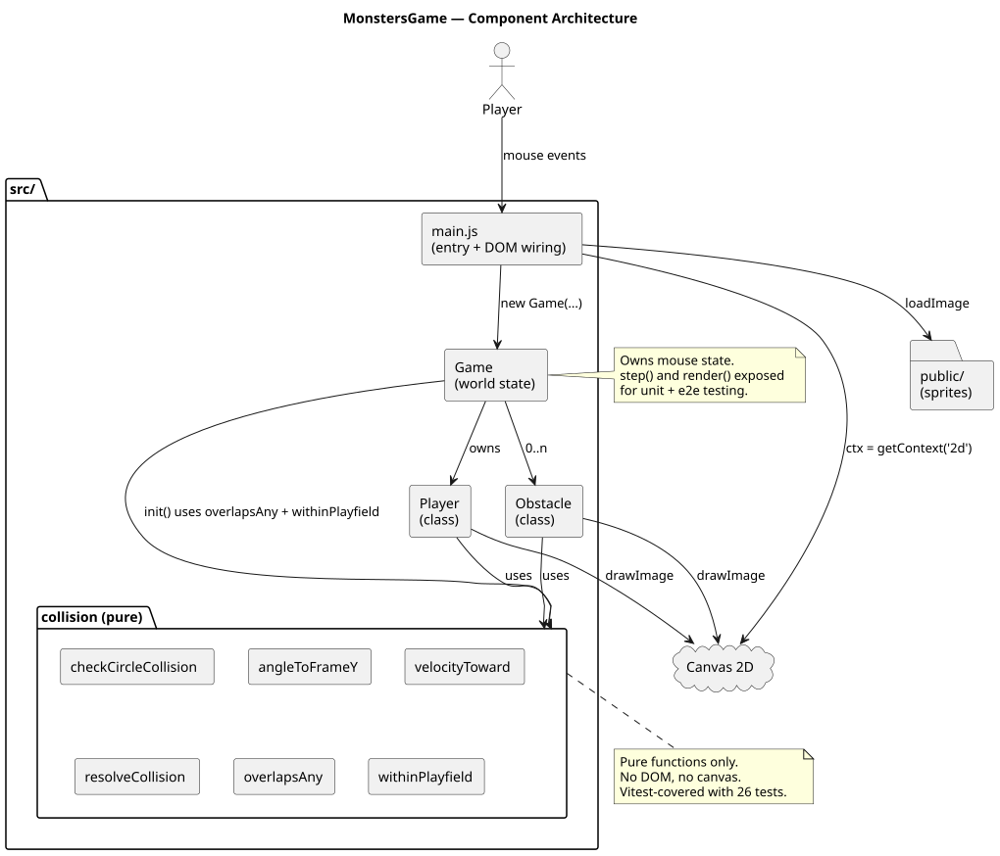
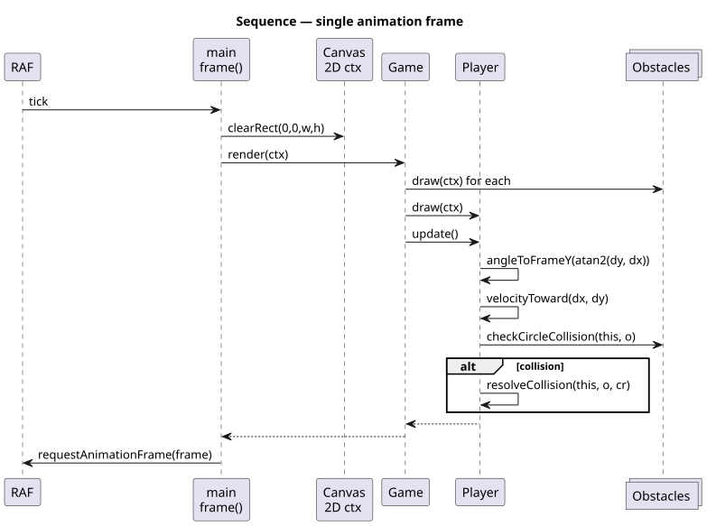
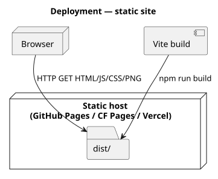

# MonstersGame

A small HTML5 canvas game — point-and-click to steer your bull around
obstacles. Now split into a pure logic core (unit-tested) and thin DOM
wiring (Playwright-tested).

[](https://github.com/tzone85/MonstersGame/actions/workflows/ci.yml)


Originally a single 256-line `script.js` with every class nested inside the
`window.load` handler — no tests, no module boundaries. The rewrite extracts
the pure collision math + game state into testable modules and adds Vite +
Vitest + Playwright + CI.

## Bug found and fixed during the port

Original `script.js:63`:
```js
if (angle < -2.74 || angle > 274) this.frameY = 6;
//                              ^^^ should be 2.74
```
`atan2` returns values in `[-π, π]` (≈ `[-3.14, 3.14]`), so `angle > 274`
is unreachable. The "up-right edge" sprite frame was never used. Now covered
by a regression test in `tests/unit/collision.test.js`:

```js
[-3.14, 6], [-2.75, 6], [3.14, 6], [3.0, 6]   // would have been wrong in the original
```

## Architecture

### Components



### Single frame



### Deployment



Diagrams are PlantUML under `docs/architecture/*.puml`; rendered SVGs are
checked in. Regenerate with `./scripts/render_diagrams.sh` (`brew install plantuml`).

## Quick start

```bash
npm install
npm run dev          # vite dev server on :5173
npm run build        # produces dist/
npm run preview      # serves dist/ on :4173
npm test             # vitest + coverage (85% gate on pure modules)
npm run test:e2e     # playwright vs preview
npm run lint
```

## Project layout

```
src/
├── main.js                    # entrypoint — loads sprites, wires mouse events
├── main.css
└── game/
    ├── collision.js           # PURE: checkCircleCollision, angleToFrameY,
    │                          # velocityToward, resolveCollision, overlapsAny,
    │                          # withinPlayfield (no DOM)
    ├── player.js              # Player class — uses collision.js
    ├── obstacle.js            # Obstacle class — uses Math.random (injectable RNG)
    └── game.js                # Game class — owns mouse + obstacles, step + render
public/                        # sprite PNGs served verbatim by Vite
tests/unit/                    # vitest happy-dom — 32 cases on collision + Game
tests/e2e/                     # playwright chromium — canvas-smoke
docs/architecture/             # PlantUML + SVGs
.github/workflows/ci.yml
```

## Tests

| Suite                              | Count   | What                                                  |
|------------------------------------|---------|-------------------------------------------------------|
| `tests/unit/collision.test.js`     | 26      | Circle collision, angle→frame (incl. bug regression), velocity, resolve, packing, playfield bounds |
| `tests/unit/game.test.js`          | 6       | Defaults, init() bounded obstacles, mouse state, step() player movement |
| `tests/e2e/canvas-smoke.spec.js`   | 2       | Canvas renders + animation runs without page errors; mouse drag moves the player |
| **Total**                          | **34**  | 85% line / 80% branch gate on `src/game/**`           |

## CI

Lint → unit + coverage → Playwright e2e → Vite build. Playwright artifacts uploaded for 14 days.

## License

MIT — see [LICENSE](LICENSE).
